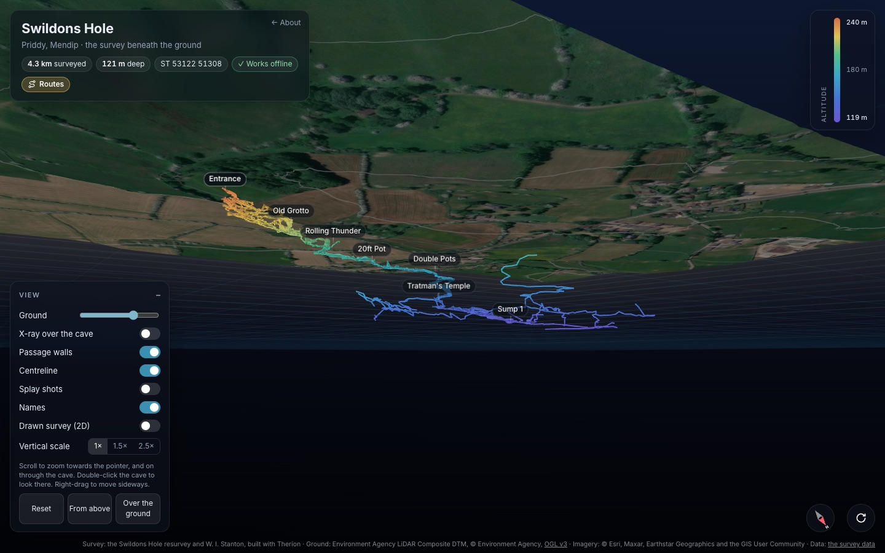
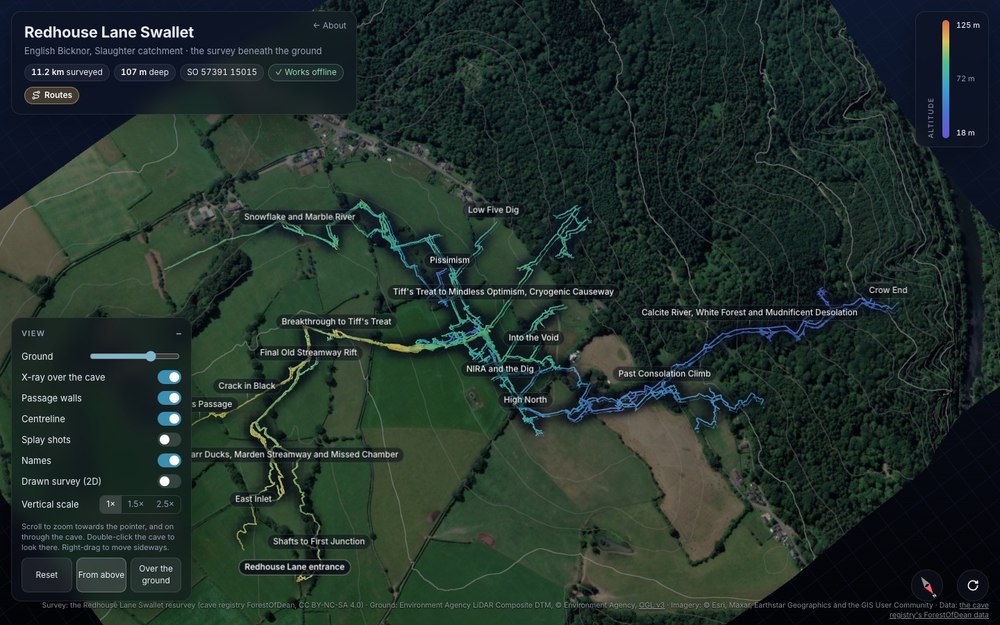
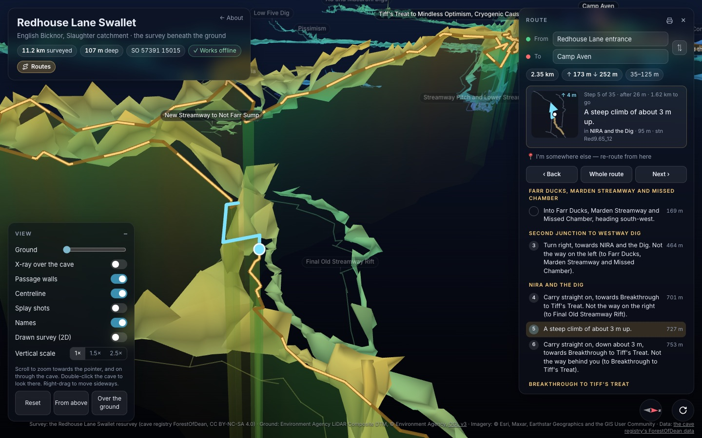
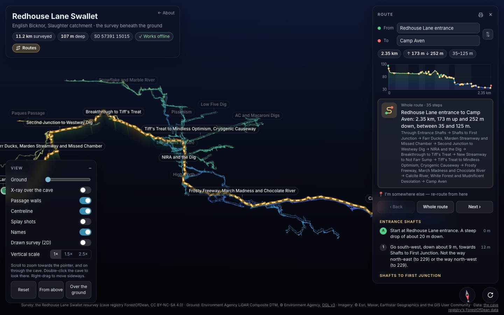
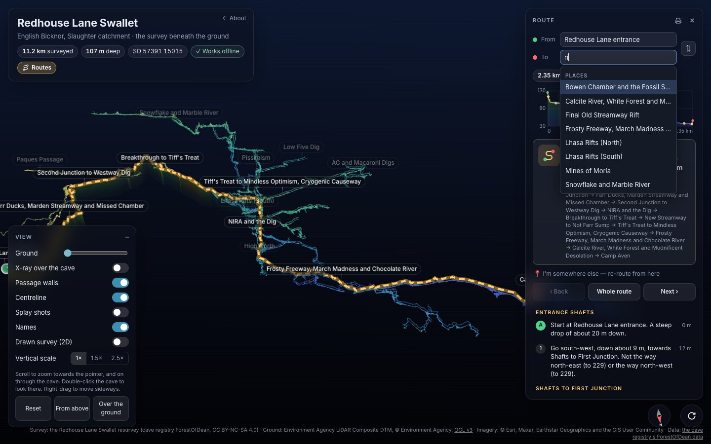
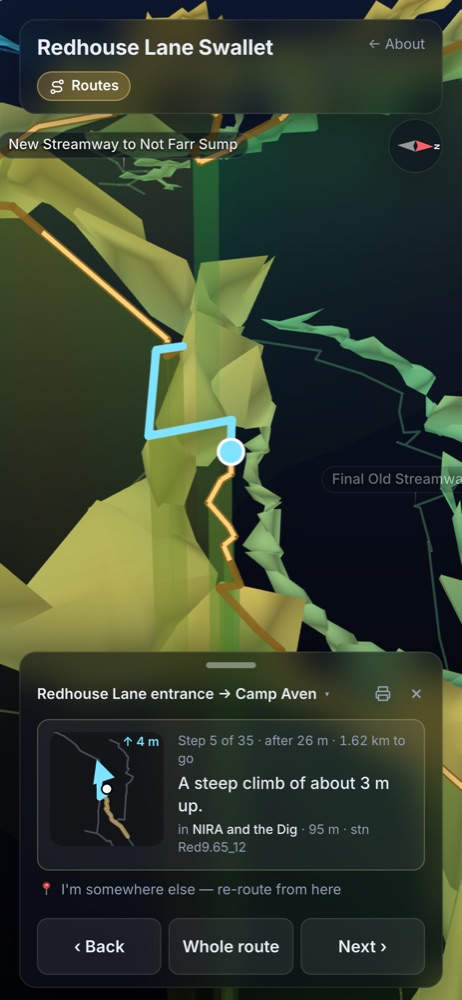
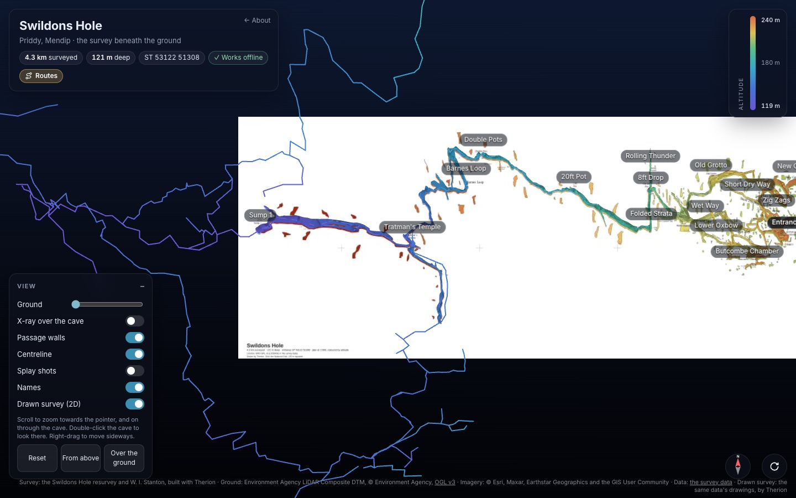
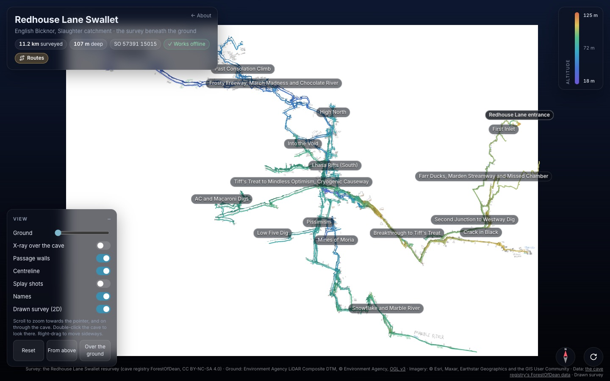
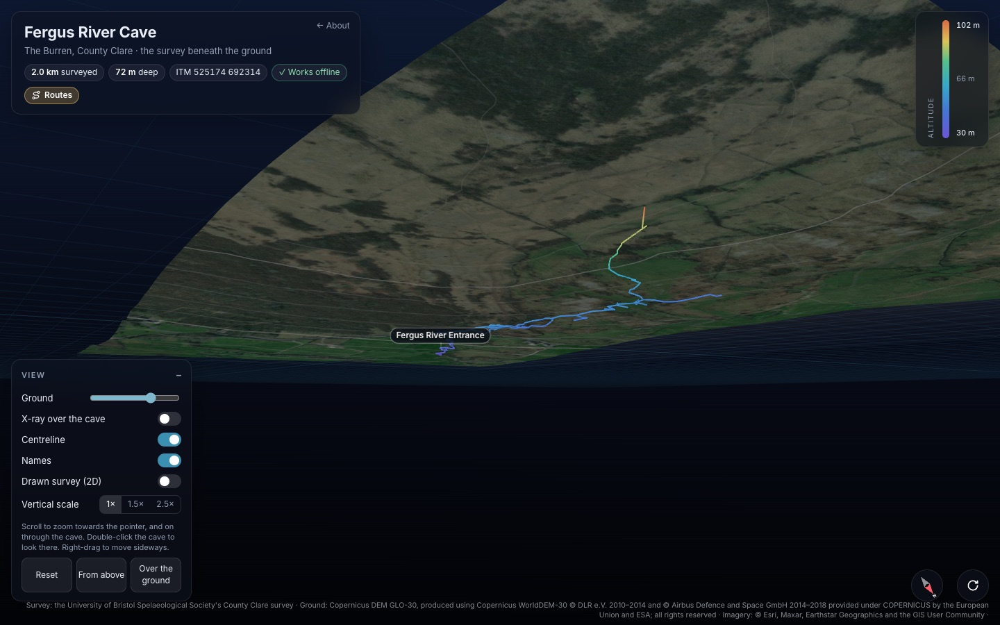
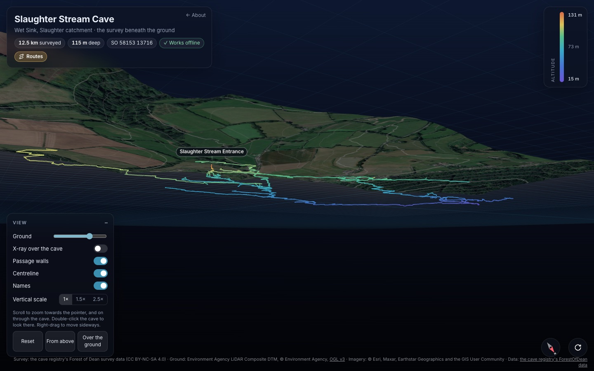

# cave-viewer

A cave survey in 3D beneath the LiDAR ground and satellite imagery, in the
browser. Plan a route between any two places in the cave and step through it,
see the drawn survey as a 2D plan, look at the passage walls, put the cave on
the table in AR, and take it underground: once opened, a page works with no
signal.



It's one viewer and its Python build tools, configured per cave repo rather
than copied into each. A cave repo holds its survey data and a config
(`caves.json`); cave-viewer turns them into a static site, one page per cave
(and a landing page for several), ready for GitHub Pages.

```bash
python -m caveviewer build caves.json --out site/
```

**See it working:** [Swildon's Hole](https://cavesurveying.github.io/gb.mendips.swildons-hole/3d/)
(Mendip) and [Ogof Draenen](https://cavesurveying.github.io/gb.south-wales.draenen/3d/)
(South Wales), each built from its own repo:
[gb.mendips.swildons-hole](https://github.com/CaveSurveying/gb.mendips.swildons-hole) and
[gb.south-wales.draenen](https://github.com/CaveSurveying/gb.south-wales.draenen).

- [What it does](#what-it-does)
- [Building a site](#the-steps)
- [Adding a cave repo](#adding-a-cave-repo)
- [Related CaveSurveying repos](#related-cavesurveying-repos)
- [Licence and credits](#licence-and-credits)

## What it does

### The cave beneath the ground

The survey sits under the real ground: the Environment Agency's or the Welsh
Government's 1 m LiDAR, or the Copernicus 30 m model where there's none, draped
with satellite imagery. The passages are coloured by height (the scale is
top right), with the cave's own place names on them.

- **Drag** to turn and tilt, **scroll or pinch** to zoom (towards the pointer,
  and on through the cave), **right-drag** to move sideways, and
  **double-click** the cave to look there. **R** spins it; it stops while
  you're handling it.
- **On a keyboard**: the arrows turn and tilt, **W A S D** move over the
  ground the way you're facing, **Q** and **E** go down and up, and **+** and
  **−** zoom. Hold them to keep going, with shift for faster. (With a route
  open, left and right are its Back and Next.)
- **Ground** fades the surface from solid to gone. **X-ray over the cave**
  thins it just where the cave is behind it, from wherever you look, so the
  passages show through the fields with the ground still around them.
- **Vertical scale** stretches depth 1.5 or 2.5 times, for a cave that's
  long and shallow.
- **From above** and **Over the ground** are quick views; the compass faces
  north when tapped, and on a phone turns the view with the phone.
- Close in, the imagery sharpens round where you're looking (over a whole
  area's page it's otherwise a few metres a pixel).
- **`#at=`** in a link opens the view on one entrance or survey, framing it:
  `#at=Goughs` frames every station of the survey named Goughs, for a page of
  many caves to link straight to each.



### Passage walls, splays and names

- **Passage walls**, built by Therion from the cave's drawings (and pushed out
  to its splays), or from any Therion `.lox` you give it (Therion's walls from
  a survey's splays, say).
- **Splay shots** and the **centreline** each on their own switch.
- **Names**: entrances (named after their caves even where one survey holds a
  whole area's), and places from the drawings or the config. The nearest name
  in each spot shows; the rest appear as you zoom in.



### Routes through the cave

**Routes** finds the way between any two places, along the passages: the
shortest, keeping to the usual ways (the config's `ways`) and away from what it
says to avoid, and through a sump only if there's no other way.

- **Type to find a place.** From and To match anywhere in the name, entrances
  first. To lists only the places joined to From underground, so in a whole
  area's data (the Three Counties System's 157 entrances, say) you pick from
  the system you're in.
- **The whole route**: its length, the climbing and descending, its height
  along the way, and the passages it goes through.
- **Step by step**: each junction drawn from above the way you arrive at it,
  which way to go and which ways not to take, how far, and how much up or down.
  **Next** and **Back** (or the arrow keys) fly to each step.
- **I'm somewhere else**: pick the passage you're in and it re-routes from
  there.
- **Trips**: ready-made routes from the config (a round trip, say).
- **Print** the route as a card to take with you.
- The address keeps the route, the step and the view's settings (the plan,
  X-ray, the vertical scale), so a link opens it as you left it.





### On a phone, underground, and in AR



- The route panel becomes a sheet at the bottom: pull it up for the whole
  route, down for the cave.
- **Works offline**: the page keeps everything it needs (the survey, the
  ground, the imagery you've seen and the drawn survey) once it's been opened
  with a signal, and a new build replaces the saved copy next time.
- **View in AR**: on an iPhone or iPad, the cave and its ground as a model on
  the table or the floor (AR Quick Look); on Android and headsets, WebXR.
- An installable web app, with its own icon.

<br clear="right">

### The drawn survey as a 2D plan

**Drawn survey (2D)** flattens the cave onto its drawn survey, seen from above,
with the centreline and names on it:

- a Therion survey's own plan, drawn by Therion and placed by its grid labels,
  with a title block;
- or a scanned drawing (or any image), fitted to the survey by
  `python -m caveviewer fit`. Keep a private drawing out of git and it's only
  in a local build.





### England, Wales, Ireland

| | grid | ground |
|---|---|---|
| England | British National Grid | Environment Agency 1 m LiDAR (`ea`) |
| Wales | British National Grid | Welsh Government 1 m LiDAR (`wales`) |
| Ireland, or anywhere | Irish Transverse Mercator (`grid.crs: itm`), or the National Grid | Copernicus 30 m DEM (`copernicus`) |

A Survex `.3d` (Compass `.DAT` files go in through Survex) or a Therion
project. Big areas work too: the ground is drawn in tiles, each only as finely
as it shows, so the 120 km Three Counties System, under 62 km² of ground, turns
smoothly.





*Screenshots: Swildon's Hole from [gb.mendips.swildons-hole](https://github.com/CaveSurveying/gb.mendips.swildons-hole)
(GPL 3.0); Redhouse Lane Swallet and Slaughter Stream Cave from the cave
registry's ForestOfDean data (CC BY-NC-SA 4.0); Fergus River Cave from the
University of Bristol Spelaeological Society's County Clare survey (outputs
CC BY-SA-NC 4.0). Ground: Environment Agency LiDAR (OGL v3); Copernicus DEM
GLO-30, produced using Copernicus WorldDEM-30 © DLR e.V. 2010–2014 and © Airbus
Defence and Space GmbH 2014–2018 provided under COPERNICUS by the European Union
and ESA. Imagery: © Esri, Maxar, Earthstar Geographics and the GIS User
Community.*

## What it needs

Python 3.10+ with numpy and Pillow; for a Therion survey, Therion, Survex
(`cavern`) and Subversion; for a Therion drawing or the preview pictures,
Chrome (set `CHROMIUM` to it, if it isn't in the usual place on a Mac).

## The steps

`python -m caveviewer build <config> --out <site>` runs them all, in order;
`--steps model,drawn` runs some, and cave ids after the config build only
those caves.

1. **survey**: each cave's centreline and names, in the work folder
   (`<work>/<cave>/`, `build/` by default). A Therion survey is checked out
   with Subversion (if the config gives a URL; `--no-fetch` skips the
   update) and built with Therion: its centreline (`cave.3d`), its plan
   (`plan.svg`) and the same as GIS layers (`esri/`), whose labels become
   place names. A Survex survey is a `.3d` already in the repo. Either way
   it writes `names.json`: the entrances, the places by station, and the
   config's ways, trips, codes, avoid, alone and sumps.
2. **model**: each cave's 3D view in `<site>/<path>/`: `scene.json`,
   `terrain.bin`, `index.html` (the viewer with the cave's name, area and
   credits in it), the manifest, icons, three.js and the font, and the
   service worker (`sw.js`, with caches of its own per cave).
3. **drawn**: the drawn survey for the 2D plan, as tiles in
   `<site>/<path>/drawn/`.
4. **index**: the landing page `<site>/index.html`, for a repo of several
   caves.

`python -m caveviewer check <config>` reads the config and says what it
would build; `python -m caveviewer fit <config>` fits a scanned drawing to
the survey (below).

## The inputs, chosen by the config

| what | `type` | |
|---|---|---|
| centreline | `survex` | a Survex `.3d` file (v3 to v8) |
| | `therion` | a Therion project, built to a `.3d` (and a plan and GIS layers) |
| names | — | the config's own (and a `names.file` to start from), plus Therion's GIS labels for a Therion survey |
| terrain | `ea` | the Environment Agency's 1 m LiDAR composite DTM (England), by WCS |
| | `wales` | the Welsh Government's 1 m LiDAR DTM 2020-22, by its WFS tile catalogue |
| | `copernicus` | the Copernicus 30 m DEM (GLO-30), anywhere, from its public copy on AWS: for where there's no LiDAR (Ireland). A surface model, so trees and buildings are in it |
| | `flat` | no LiDAR: level ground just above the cave (for tests, or elsewhere) |
| grid | `grid.crs: osgb` | the British National Grid (the default) |
| | `grid.crs: itm` | Irish Transverse Mercator: the imagery placed by it, and grid references as `ITM 525174 692314` |
| drawn survey | `therion-svg` | the plan Therion draws, placed by its grid labels, with a title block |
| | `scan` | a scanned drawing, fitted to the survey (`python -m caveviewer fit`) |
| | `none` | |
| walls | `walls.type: therion` | built by Therion from a Therion survey's drawings (not its splays), then put back on the centreline and pushed out to the splays |
| | `walls.lox` | a Therion `.lox` with the passage walls, already in the repo |

And the page's features, all on unless the config turns them off:
`features: {"routes", "directions", "drawn", "walls", "ar", "offline"}`.

Every key is in [`caveviewer/schema.json`](caveviewer/schema.json) (a JSON
Schema, with a description for each). Paths are relative to the config's
folder.

## Adding a cave repo

1. Make the repo: the survey data (or where to check it out from), a
   `caves.json`, a `requirements.txt` and a `.gitignore`:

   ```
   # requirements.txt: cave-viewer, pinned to a tag
   cave-viewer @ git+https://github.com/CaveSurveying/cave-viewer@v0.5.4
   ```

   ```
   # .gitignore: what's built (and any data that isn't to be published)
   /build/
   /site/
   /lidar/
   ```

2. Write `caves.json`. One cave, from a Survex file, in Wales:

   ```json
   {
     "caves": [{
       "id": "example",
       "name": "Example Cave",
       "area": "Somewhere in Wales",
       "path": "3d",
       "credit": "Example Cave survey, &copy; its surveyors",
       "survey": {"type": "survex", "file": "data/example.3d"},
       "names": {"file": "data/names.json"},
       "terrain": {"type": "wales", "step": 4},
       "drawn": {"type": "scan", "image": "local/drawn.png", "fit": "local/drawn-georef.json",
                 "credit": "Drawn survey © its surveyors"}
     }]
   }
   ```

   Several caves from one Therion dataset share their settings through
   `defaults`, each cave adding its own (the Cheddar repo's `caves.json` is
   a full example):

   ```json
   {
     "site": {"title": "Mendip caves in 3D", "lede": "…", "footer": "… {credits}."},
     "defaults": {
       "grid": {"offset": [300000, 100000]},
       "survey": {"type": "therion", "svn": "http://www.cave-registry.org.uk/svn/CheddarCatchment", "checkout": "registry"},
       "terrain": {"type": "ea"},
       "drawn": {"type": "therion-svg"}
     },
     "caves": [
       {"id": "gb", "name": "GB Cave", "survey": {"dir": "GB", "source": "GB.th", "svx": ["GB.svx"]},
        "ways": [["GB Entrance", "Gorge", "Ladder Dig"]]}
     ]
   }
   ```

   `grid.offset` puts the survey on the full National Grid: Therion's
   export on the ST square is `[300000, 100000]`; a `.3d` already on the
   full grid is `[0, 0]` (the default). A survey on Irish Transverse Mercator
   says so with `"grid": {"crs": "itm"}`, and takes `"terrain": {"type":
   "copernicus"}` for its ground.

3. Install and build:

   ```bash
   python3 -m venv .venv && . .venv/bin/activate
   pip install -r requirements.txt
   python -m caveviewer build caves.json --out site/
   python -m http.server -d site     # then open http://localhost:8000
   ```

   (Working on cave-viewer itself alongside: `pip install -e ../cave-viewer`
   instead.)

4. To publish it on GitHub Pages, call the reusable workflow from the
   cave repo (Settings → Pages → Source: GitHub Actions):

   ```yaml
   # .github/workflows/pages.yml
   on: { push: { branches: [main] }, workflow_dispatch: {} }
   permissions: { contents: read, pages: write, id-token: write }
   jobs:
     site:
       uses: CaveSurveying/cave-viewer/.github/workflows/build.yml@v0.5.4
       with:
         config: caves.json
         apt-packages: therion survex subversion   # for a Therion survey
   ```

   Only publish what the data's licence allows: whatever is in the repo,
   or is fetched by the build, ends up in the site.

### Private drawings

A `scan` drawn survey is built only where its `image` is there: keep a
private drawing out of git (in a gitignored `local/`, say) and a build
elsewhere, GitHub Actions included, leaves the drawn survey out. A local
build that has it makes it into `site/`, so don't publish that build.

### Fitting a scanned drawing

```bash
python -m caveviewer fit caves.json [cave]
```

finds the entrance triangles on the drawing (red), matches them to the
survey's entrances, then moves, turns and scales the drawing so the most
stations sit on its passages, for the whole cave and then each 250 m
square. It writes the cave's `drawn.fit`.

## Versions

Cave repos pin cave-viewer to a tag in `requirements.txt`, so a change to
the viewer reaches a cave when its repo moves the pin. To release: bump
`__version__` in `caveviewer/__init__.py`, commit, and tag it `v<version>`.

## Developing

```bash
pip install -e .
python -m unittest discover -s tests -v
```

The test builds `tests/fixture`, a made-up cave from a Survex file
(`tests/fixture/data/tiny.svx`, built to `tiny.3d` with `cavern`), on
flat ground, so nothing is fetched.

The viewer is `caveviewer/viewer/viewer.html`; `{{NAME}}`, `{{AREA}}`,
`{{ID}}`, `{{CREDIT}}`, `{{DATA}}`, `{{DATA_HTML}}`, `{{GROUND_CREDIT}}`
and `{{DRAWN_CREDIT}}` in it are filled in per cave, and the page reads the
features turned off from `scene.json`'s `features`.

## Related CaveSurveying repos

- **Caves built with cave-viewer:**
  [gb.mendips.swildons-hole](https://github.com/CaveSurveying/gb.mendips.swildons-hole)
  (Swildon's Hole: survey data, drawings and route cards;
  [3D view](https://cavesurveying.github.io/gb.mendips.swildons-hole/3d/)) and
  [gb.south-wales.draenen](https://github.com/CaveSurveying/gb.south-wales.draenen)
  (Ogof Draenen: survey data and drawings;
  [3D view](https://cavesurveying.github.io/gb.south-wales.draenen/3d/)).
- **Drawing surveys:** [Therion-Sketching](https://github.com/CaveSurveying/Therion-Sketching)
  (turning SexyTopo and PocketTopo sketches into Therion drawings, with house
  drawing rules), [tunnelx](https://github.com/CaveSurveying/tunnelx) (Tunnel,
  2.5D cave drawing on Survex data) and
  [CheddarCatchment](https://github.com/CaveSurveying/CheddarCatchment)
  (Longwood Valley Sink, from the Cheddar Catchment Therion survey).
- **Survey data tools:** [Survex2Therion](https://github.com/CaveSurveying/Survex2Therion)
  (Survex to Therion) and [CentrelineInput](https://github.com/CaveSurveying/CentrelineInput)
  (a QGIS plugin to put in centreline data).
- **Other views of caves:** [cavegroundwindow](https://github.com/CaveSurveying/cavegroundwindow)
  (the screen as a window through the ground, by the phone's GPS and compass)
  and [earthwafer](https://github.com/CaveSurveying/earthwafer) (a flick-book
  of the ground and the caves under it).
- **Data and issues:** [NorthernEngland](https://github.com/CaveSurveying/NorthernEngland)
  (issues for the cave registry's Northern England data),
  [sandbox](https://github.com/CaveSurveying/sandbox) and the
  [Welcome_Page](https://github.com/CaveSurveying/Welcome_Page).

## Licence and credits

cave-viewer is free software under the GNU General Public License,
version 3 ([LICENSE](LICENSE)), as are the cave repos it came from. Its
AR and VR on Android and headsets (WebXR) is Rich Smith's, from
[richsmith/draenen](https://github.com/richsmith/draenen).

three.js (MIT) and the Inter font (SIL Open Font Licence) are in
`caveviewer/viewer/vendor/`, with their own licences. A cave's survey data
keeps its own licence: cave-viewer only builds the site from it. Ground:
Environment Agency and Welsh Government LiDAR, OGL v3; Copernicus DEM GLO-30,
© DLR e.V. 2010–2014 and © Airbus Defence and Space GmbH 2014–2018, provided
under COPERNICUS by the European Union and ESA. Imagery: Esri.
